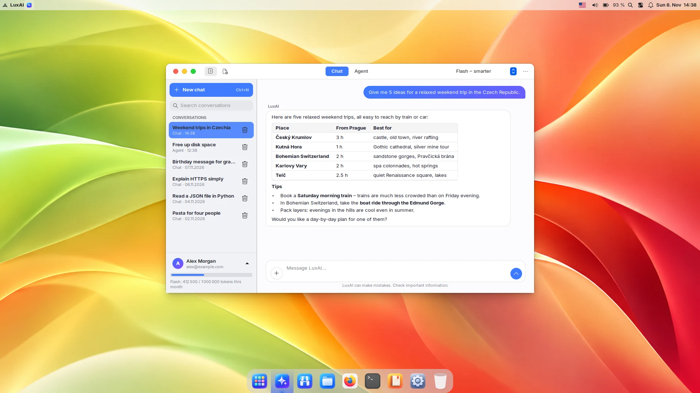

<div align="center">

# 🤖 LuxAI – the AI assistant for LuxOS

**Resmî olmayan, %100 çok dilli LuxAI paketleri — LuxOS dışındaki dağıtımlar için**

[](https://github.com/vesvese55x/LuxAI-the-AI-assistant-for-LuxOS/actions/workflows/build.yml)


-f2b13a)


**TR** | [EN](#english) | [DE](#deutsch) | [RU](#русский) | [ZH](#中文) | [JA](#日本語)

*Chat + Agent modu · 13 dil · dinamik sistem dili algılama · modern pencere düğmeleri · tek hesap*

</div>

---

## 📌 Bu depo nedir?

**LuxAI**, LuxOS'un resmî yapay zeka asistanıdır: sohbet eder ve **Agent** modunda
bilgisayarınızla gerçekten çalışır — komut çalıştırır, dosyaları yönetir, uygulama
açar, ekran görüntüsü alır. Hepsi sizin onayınızla.

Bu depo, LuxAI'yi **LuxOS dışındaki dağıtımlarda** da (Ubuntu, Debian, Fedora,
Arch, openSUSE, Windows…) kullanabilmek için oluşturuldu. Paketler, resmî
LuxOS 1.0.1 dağıtım imajından alınan **değiştirilmemiş LuxAI 2.0.2 dosyalarının**
üzerine BELGESELSEMO tarafından Z.AI desteğiyle hazırlanan topluluk yamalarının
uygulanmasıyla derlenir. Resmî bir proje değildir; LuxOS projesiyle bağı yoktur.

> 🧠 Resmî olmayan ama muhteşem bir AI asistanı — artık her dağıtımda.

## 🖼️ Ekran görüntüleri

| LuxAI — sohbet arayüzü | LuxOS masaüstü |
|:---:|:---:|
|  |  |

## ✨ Özellikler

- **İki mod, tek uygulama**
  - **Chat** — akış halinde yanıtlar, Markdown, tablolar, kod blokları (kopyala
    düğmesi + sözdizimi renklendirme), LaTeX, sohbet geçmişi kenar çubuğunda.
  - **Agent** — kabuk komutları, dosya okuma/yazma, uygulama & bağlantı açma,
    ekran görüntüsü, fare & klavye, pencere yönetimi. Her araç çağrısı kart
    olarak gösterilir; LuxAI **harekete geçmeden önce sorar**.
- **Güvenlik katmanları** — okuma sorunsuz; değişiklikler tek tek onaylanır;
  hassas dosyalar (`.ssh`, `.env`) ek onay ister; tehlikeli komutlar iki kez
  onay ister; bazı işlemler her koşulda reddedilir (`rm -rf /`, mkfs, sudo'ya
  parola besleme…). Web içeriği geldiğinde her komut ayrıca onaylanır
  (istem-enjeksiyonu koruması).
- **13 dil** — Arayüz: `Čeština · Slovenčina · English · Deutsch · Polski ·
  Français · Español · Italiano · Українська · Türkçe · Русский · 中文 · 日本語`
- **%100 çeviriler** — 16 dil dosyasının tamamı eksiksiz (457 anahtar); artık
  Türkçe seçiliyken hiçbir yerde İngilizce yazı kalmıyor.
- **Dinamik sistem dili** — GUI, sistem dilini otomatik algılar
  (`LC_ALL → LC_MESSAGES → LANG`); desteklenmeyen dillerde İngilizce gösterilir.
- **Modern pencere düğmeleri** — küçült/büyüt/kapat düğmeleri yuvarlak hover,
  ince semboller ve kırmızı kapat efektiyle yenilendi; açık/koyu temaya uyar.
- **Dropdown düzeltmesi** — dil ve ayar menüleri ilk açılışta artık bozulmuyor.
- **Yerleşik doküman arama** — çevrimdışı LSL/LuxOS kılavuzu (`docs_search`,
  `docs_read`); internet olmadan da çalışır.
- **Ekler** — mesaj başına 4 görsel + 8 dosya; Ctrl+V ile yapıştırma.
- **Tamamen çevrilmiş hesap penceresi** — giriş, kod, kayıt akışları tr/ru/zh/ja
  dahil 12 dilde.

## 📦 İndir & Kur

| Paket | Kurulum |
|---|---|
| **AppImage** | `chmod +x LuxAI-3.1.0-x86_64.AppImage && ./LuxAI-3.1.0-x86_64.AppImage` — [indir](https://github.com/vesvese55x/LuxAI-the-AI-assistant-for-LuxOS/releases/latest/download/LuxAI-3.1.0-x86_64.AppImage) |
| **deb** (Debian/Ubuntu/Mint) | `sudo apt install ./luxai_3.1.0_amd64.deb` — [indir](https://github.com/vesvese55x/LuxAI-the-AI-assistant-for-LuxOS/releases/latest/download/luxai_3.1.0_amd64.deb) |
| **rpm** (Fedora/openSUSE) | `sudo dnf install ./luxai-3.1.0-1.x86_64.rpm` — [indir](https://github.com/vesvese55x/LuxAI-the-AI-assistant-for-LuxOS/releases/latest/download/luxai-3.1.0-1.x86_64.rpm) |
| **Arch zst** | `sudo pacman -U luxai-3.1.0-1-x86_64.pkg.tar.zst` — [indir](https://github.com/vesvese55x/LuxAI-the-AI-assistant-for-LuxOS/releases/latest/download/luxai-3.1.0-1-x86_64.pkg.tar.zst) |
| **Windows exe** | `LuxAI-3.1.0-Setup.exe` (WSLg ile kurar) — [indir](https://github.com/vesvese55x/LuxAI-the-AI-assistant-for-LuxOS/releases/latest/download/LuxAI-3.1.0-Setup.exe) |

Tüm dosyalar + SHA-256: [Releases](https://github.com/vesvese55x/LuxAI-the-AI-assistant-for-LuxOS/releases)

### Tek satırla kur (Linux)

```bash
curl -fsSL https://raw.githubusercontent.com/vesvese55x/LuxAI-the-AI-assistant-for-LuxOS/main/belgeselsemo-luxai-installer | sh
```

### Windows 10/11

`LuxAI-3.1.0-Setup.exe` kurucusu, LuxAI'yi WSL içine (WSLg — Linux GUI
desteği) kurar ve Başlat menüsüne **LuxAI** kısayolu ekler. Kurucu arayüzü
sistem dilinize göre açılır (TR/EN/DE/FR/RU/ZH/JA). Kurulum birkaç dakika
sürer; ilk açılışta LuxAI hesabınızla oturum açın.

> **Gereksinimler (Linux):** `libgtk-3` + `python3-gi` (PyGObject) + `libcurl` —
> dağıtımınıza göre otomatik çözülür (deb/rpm paketleri gerçek sistem
> bağımlılıklarını kullanır; LuxOS'a özel bağımlılık YOKTUR).

## 🌍 Dil desteği

| Dil | Arayüz | Hesap penceresi | Durum |
|---|:---:|:---:|---|
| 🇹🇷 Türkçe | ✅ | ✅ | %100 (bu depo) |
| 🇷🇺 Rusça | ✅ | ✅ | %100 (bu depo) |
| 🇨🇳 Çince (Basit) | ✅ | ✅ | %100 (bu depo) |
| 🇯🇵 Japonca | ✅ | ✅ | %100 (bu depo) |
| 🇩🇪 Almanca | ✅ | ✅ | %100 |
| 🇫🇷 Fransızca | ✅ | ✅ | %100 |
| 🇨🇿 Çekçe · 🇸🇰 Slovakça · 🇪🇸 İspanyolca · 🇮🇹 İtalyanca · 🇳🇱 Felemenkçe · 🇵🇱 Lehçe · 🇵🇹 Portekizce · 🇸🇪 İsveççe · 🇺🇦 Ukraynaca | ✅ | ✅ | %100 |
| İngilizce | ✅ | ✅ | varsayılan / geri dönüş dili |

Dil listesi binary içinden dıştan yüklenen `i18n/*.tsv` dosyalarıyla çalışır;
**Slovakça slotuna dil sıkıştırmaya gerek kalmadı** — kaynak dosyası içindeki
sabit boyutlu dil listesi 13 dile güvenle genişletildi.

## 🆕 3.1.0'da neler var?

- ✅ **Menü ikonu düzeltmesi** — tüm paketler `hicolor` ikonlarını (16–512px)
  kurar + tam çevrilmiş `.desktop` dosyası → uygulama menüsünde ikon görünür.
- ✅ Türkçe + Rusça + Çince + Japonca %100 arayüz çevirisi.
- ✅ Dinamik sistem dili algılama (varsayılan dil artık sabit değil).
- ✅ Modern pencere düğmeleri + dropdown ilk-kare düzeltmesi.
- ✅ Sohbet kutusunun üstünde, seçili dilde BELGESELSEMO imzası ve
  [belgeselsemo.com.tr](http://belgeselsemo.com.tr) bağlantısı.
- ✅ Windows kurucusu (WSLg), GitHub Actions ile otomatik build + release.
- ✅ Arch paketi artık var olmayan `luxos-account` / `luxos-i18n` / `luxos-docs`
  bağımlılıkları istemiyor — gereken bileşenler paketle birlikte kurulur.

## 🛠️ Kaynaktan derleme

```bash
git clone https://github.com/vesvese55x/LuxAI-the-AI-assistant-for-LuxOS.git
cd LuxAI-the-AI-assistant-for-LuxOS
bash packaging/build-all.sh     # deb + rpm + zst + AppImage → .work/dist
bash packaging/build-exe.sh     # Windows kurucusu (mingw-w64 gerekir)
```

- `src/vendor/` — LuxOS 1.0.1 imajından alınan değiştirilmemiş resmî paketler
  (`luxai 2.0.2-3`, `luxos-account`, `luxos-i18n`, `luxos-docs`).
- `src/luxai/patches/` — binary dil-listesi yaması + modern CSS.
- `src/luxai/i18n/` — çeviri kaynakları (tr/ru/zh/ja tam çeviri + hesap pencereleri).
- `packaging/` — derleme scriptleri; CI bunları GitHub Actions'ta çalıştırır
  ve her `v*` etiketi için Release oluşturur.

## 🌐 BELGESELSEMO ekosistemi

| Proje | Açıklama |
|---|---|
| [IDM-LINUX](https://github.com/vesvese55x/IDM-LINUX) | Linux'ta IDM deneyimi (Wine + Python panosu) |
| [belgeselsemo.com.tr](http://belgeselsemo.com.tr) | BELGESELSEMO resmî site |
| LuxAI paketleri | Bu depo — %100 çok dilli LuxAI |

LuxAI paketleri BELGESELSEMO tarafından, Z.AI sayesinde orijinal LuxOS
dağıtımından elde edilerek Linux/Windows paketleri olarak derlenmiştir.

## ⚖️ Hukuki not

LuxAI ve LuxOS, LuxOS projesine aittir: [luxos.lux-ai.cz](https://luxos.lux-ai.cz).
Bu depo **resmî değildir**, LuxOS projesi tarafından onaylanmamıştır veya
desteklenmemektedir. Uygulama dosyaları değiştirilmeden resmî dağıtım
imajından alınır; bu depoya özgü olan kısımlar (çeviriler, yamalar, paket
betikleri, Windows kurucusu) MIT lisansıyla yayımlanır — bkz. [LICENSE](LICENSE).

---

<a id="english"></a>
<details>
<summary><b>🇬🇧 English</b></summary>

### LuxAI – the AI assistant for LuxOS (unofficial multi-distro build)

**LuxAI** is the official AI assistant of LuxOS: it chats and, in **Agent** mode,
actually works with your computer — runs commands, manages files, opens apps,
takes screenshots, always with your approval.

This repository exists so LuxAI can also be used **outside LuxOS** (Debian,
Ubuntu, Fedora, Arch, openSUSE, Windows…). Packages are built by applying
community patches by **BELGESELSEMO** (with Z.AI assistance) on top of the
**unmodified LuxAI 2.0.2 files** taken from the official LuxOS 1.0.1 image.
Unofficial — not affiliated with or endorsed by the LuxOS project.

**Highlights:** 13 interface languages (cs, sk, en, de, pl, fr, es, it, uk +
tr, ru, zh, ja) with 100% complete translation files, dynamic system-language
detection with English fallback, modern window buttons, fixed dropdown
rendering, BELGESELSEMO signature above the chat input in the selected
language, installed hicolor icons (app-menu icon fix), Windows setup via WSLg.

**Install:** see the table above, or

```bash
curl -fsSL https://raw.githubusercontent.com/vesvese55x/LuxAI-the-AI-assistant-for-LuxOS/main/belgeselsemo-luxai-installer | sh
```

**Requirements (Linux):** `libgtk-3`, `python3-gi` (PyGObject), `libcurl` —
resolved automatically by your distro. No LuxOS-specific dependencies.

**Build from source:** `bash packaging/build-all.sh` (Linux packages) and
`bash packaging/build-exe.sh` (Windows installer, needs mingw-w64).

</details>

<a id="deutsch"></a>
<details>
<summary><b>🇩🇪 Deutsch</b></summary>

### LuxAI – der KI-Assistent für LuxOS (inoffizieller Multi-Distro-Build)

LuxAI ist der offizielle KI-Assistent von LuxOS: Er chattet und arbeitet im
**Agent-Modus** tatsächlich mit Ihrem Computer – Befehle, Dateien, Apps,
Screenshots, immer mit Ihrer Zustimmung.

Dieses Repository gibt es, damit LuxAI auch **außerhalb von LuxOS** genutzt
werden kann (Debian, Ubuntu, Fedora, Arch, openSUSE, Windows…). Die Pakete
entstehen, indem von **BELGESELSEMO** (mit Z.AI-Unterstützung) erstellte
Community-Patches auf die **unveränderten LuxAI-2.0.2-Dateien** aus dem
offiziellen LuxOS-1.0.1-Image angewendet werden. Inoffiziell – nicht mit dem
LuxOS-Projekt verbunden.

**Highlights:** 13 Oberflächensprachen inkl. Deutsch, dynamische
Systemsprachenerkennung mit Englisch-Fallback, moderne Fensterschaltflächen,
korrigierte Dropdown-Darstellung, installierte Hicolor-Icons,
Windows-Installer über WSLg.

```bash
curl -fsSL https://raw.githubusercontent.com/vesvese55x/LuxAI-the-AI-assistant-for-LuxOS/main/belgeselsemo-luxai-installer | sh
```

</details>

<a id="русский"></a>
<details>
<summary><b>🇷🇺 Русский</b></summary>

### LuxAI – ИИ-ассистент LuxOS (неофициальная сборка для других дистрибутивов)

LuxAI — официальный ИИ-ассистент LuxOS: он общается и в **режиме агента**
реально работает с вашим компьютером — команды, файлы, приложения,
скриншоты, всегда с вашего одобрения.

Репозиторий создан, чтобы LuxAI можно было использовать **вне LuxOS**
(Debian, Ubuntu, Fedora, Arch, openSUSE, Windows…). Пакеты собраны
применением пользовательских патчей от **BELGESELSEMO** (при помощи Z.AI)
к **немодифицированным файлам LuxAI 2.0.2** из официального образа
LuxOS 1.0.1. Неофициально — не связано с проектом LuxOS.

**Возможности:** 13 языков интерфейса (включая русский), динамическое
определение языка системы с откатом на английский, современные кнопки окна,
исправленное отображение выпадающих списков, подпись BELGESELSEMO над полем
ввода на выбранном языке, установленные иконки hicolor, установщик Windows
через WSLg.

</details>

<a id="中文"></a>
<details>
<summary><b>🇨🇳 中文</b></summary>

### LuxAI – LuxOS 的 AI 助手（非官方多发行版构建）

LuxAI 是 LuxOS 的官方 AI 助手：它既能聊天，又能在**智能体模式**下真正操作您的
电脑——运行命令、管理文件、打开应用、截屏，一切均需您的批准。

本仓库的目的是让 LuxAI 也能在 **LuxOS 之外**的发行版中使用（Debian、Ubuntu、
Fedora、Arch、openSUSE、Windows…）。包文件是在**未修改的 LuxAI 2.0.2 文件**
（取自官方 LuxOS 1.0.1 镜像）之上应用 BELGESELSEMO 社区补丁（借助 Z.AI）构建的。
非官方项目，与 LuxOS 项目无关联。

**亮点：** 13 种界面语言（含中文），动态检测系统语言并回退到英语，现代化窗口
按钮，修复下拉菜单渲染，聊天输入框上方以所选语言显示 BELGESELSEMO 署名，
已安装 hicolor 图标，通过 WSLg 的 Windows 安装程序。

</details>

<a id="日本語"></a>
<details>
<summary><b>🇯🇵 日本語</b></summary>

### LuxAI – LuxOS の AI アシスタント（非公式マルチディストロビルド）

LuxAI は LuxOS の公式 AI アシスタントです。チャットで会話でき、**エージェント
モード**では実際にコンピューターで作業します。コマンドの実行、ファイル管理、
アプリの起動、スクリーンショット。すべてあなたの承認の下で行われます。

このリポジトリは、LuxAI を **LuxOS 以外の**ディストリビューション（Debian、
Ubuntu、Fedora、Arch、openSUSE、Windows…）でも使えるようにするために作られま
した。パッケージは、公式 LuxOS 1.0.1 イメージから取得した**無修正の LuxAI
2.0.2 ファイル**に、BELGESELSEMO が Z.AI の協力を得て作成したコミュニティ
パッチを適用してビルドされます。非公式であり、LuxOS プロジェクトとは関係ありません。

**ハイライト：** 13 のインターフェース言語（日本語を含む）、システム言語の動的
検出と英語へのフォールバック、モダンなウィンドウボタン、ドロップダウン描画の
修正、選択した言語で表示される BELGESELSEMO の署名、hicolor アイコンのインストール、
WSLg による Windows インストーラー。

</details>

---

<div align="center">

**BELGESELSEMO tarafından Z.AI sayesinde orijinal LuxOS distrosundan elde edilerek
Linux/Windows paketler olarak derlenmiştir · [belgeselsemo.com.tr](http://belgeselsemo.com.tr)**

</div>
