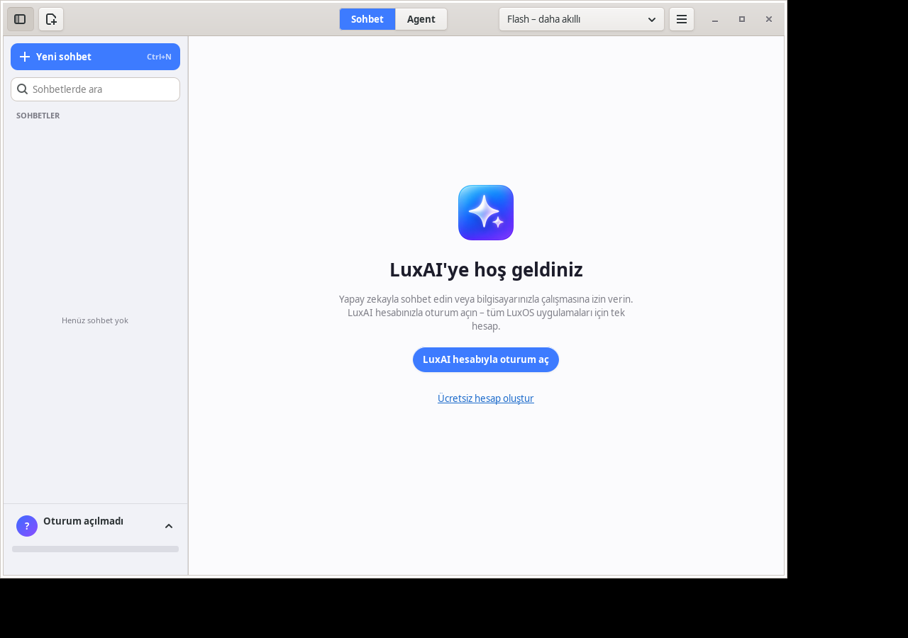
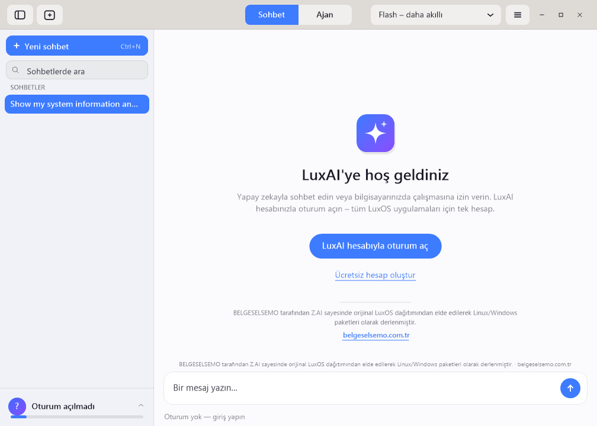
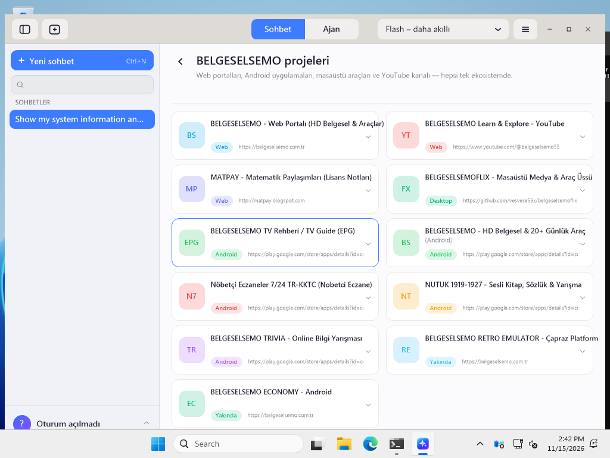
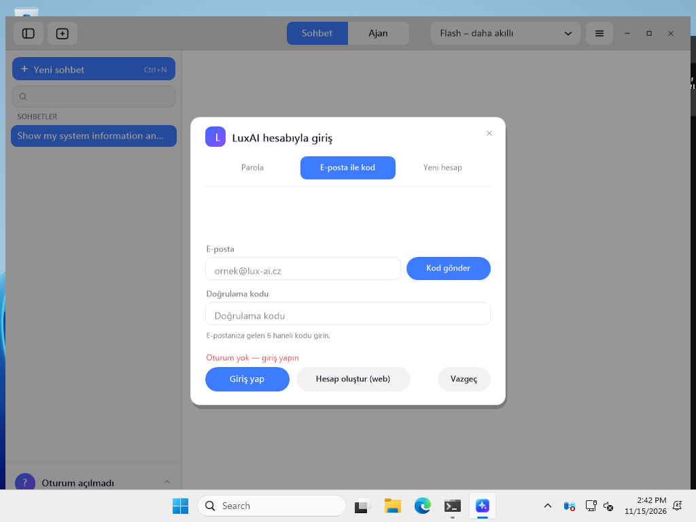
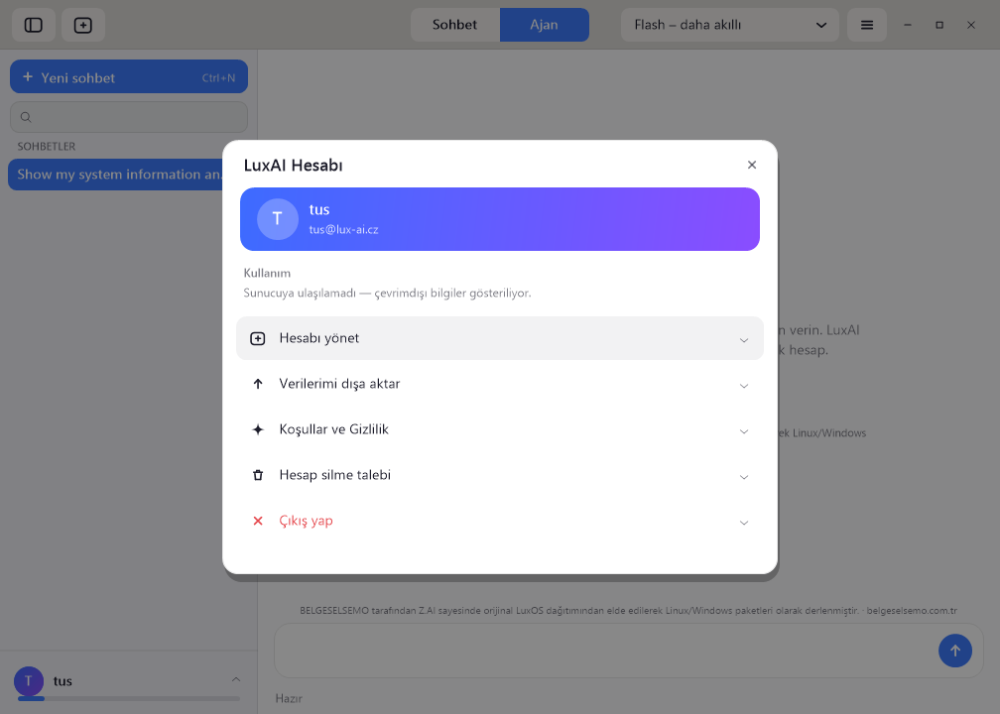
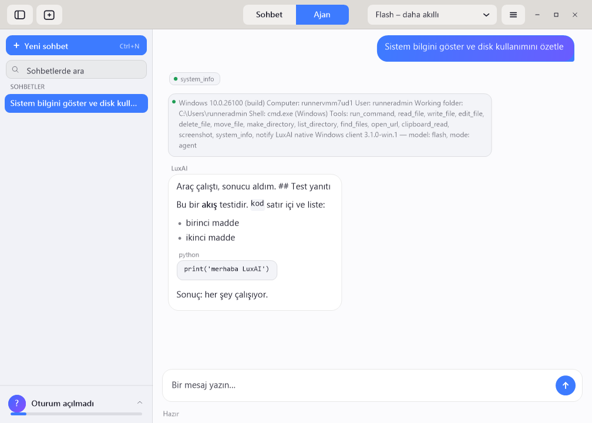
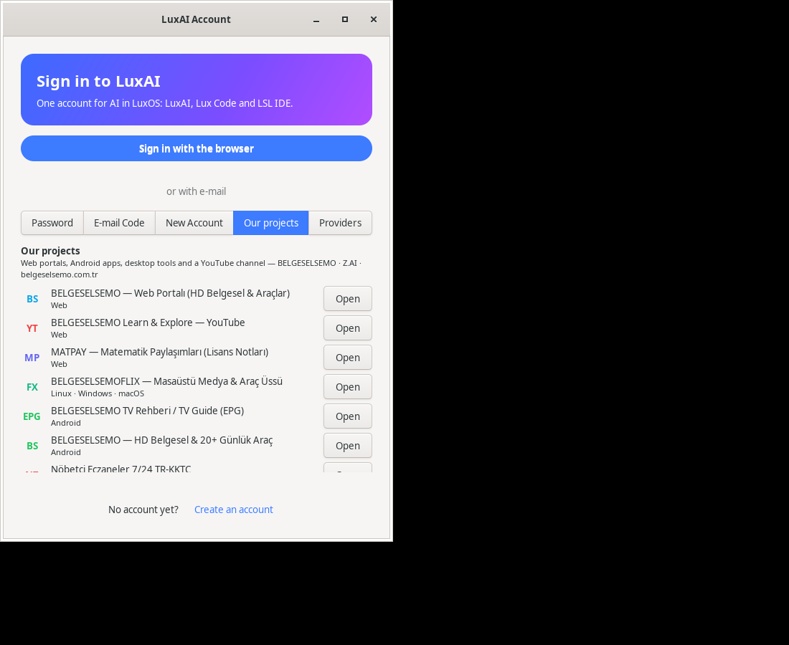
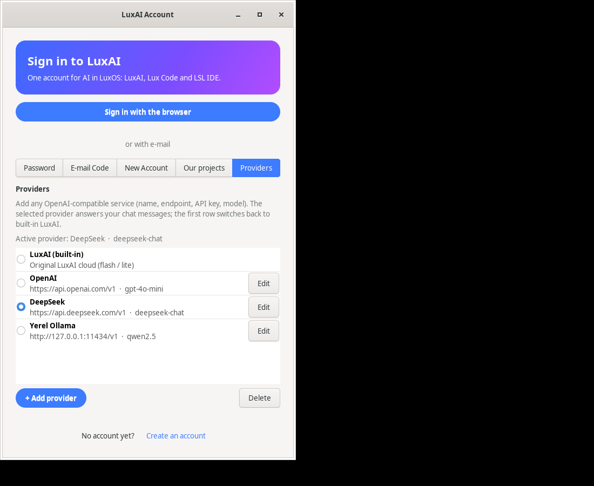
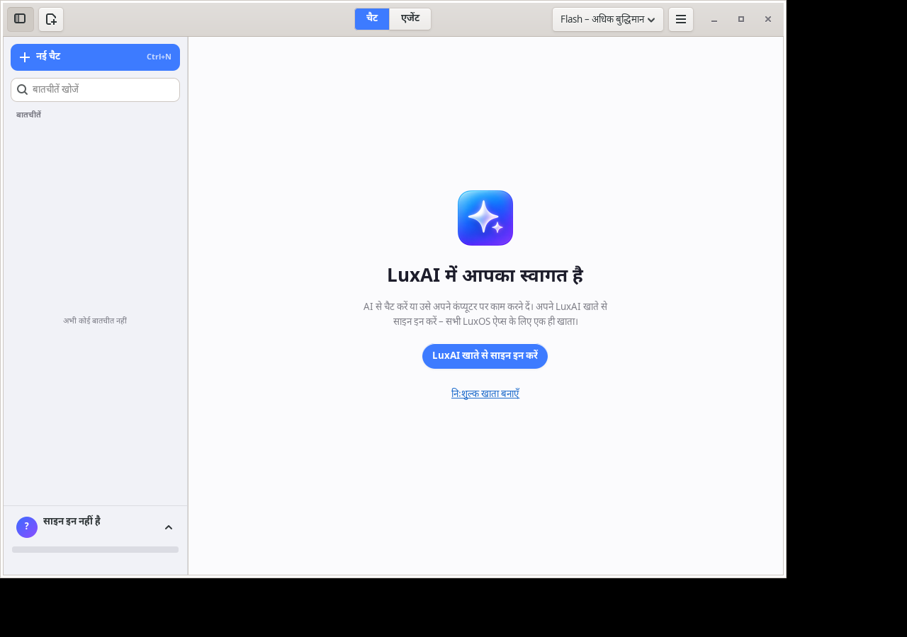

# 🤖 LuxAI – the AI assistant for LuxOS (Unofficial multi-distro build)

<p align="center">
  <a href="#-luxai--the-ai-assistant-for-luxos-unofficial-multi-distro-build">🇹🇷 <strong>Türkçe</strong></a> ·
  <a href="#english">🇬🇧 English</a> ·
  <a href="#deutsch">🇩🇪 Deutsch</a> ·
  <a href="#русский">🇷🇺 Русский</a> ·
  <a href="#中文">🇨🇳 中文</a> ·
  <a href="#日本語">🇯🇵 日本語</a> ·
  <a href="#हिन्दी">🇮🇳 हिन्दी</a>
</p>

> [!NOTE]
> <p><strong>✨ Resmî olmayan ama muhteşem bir AI asistanı</strong><br>
> 
> 
> </p>
>
> <p align="justify">LuxAI, LuxOS'un resmî yapay zeka asistanıdır: sohbet eder ve <strong>Agent</strong> modunda bilgisayarınızla gerçekten çalışır — komut çalıştırır, dosyaları yönetir, uygulama açar, ekran görüntüsü alır; her adım sizin onayınızla. Bu depo, LuxAI'nin LuxOS dışındaki dağıtımlarda da (Ubuntu, Debian, Fedora, Arch, openSUSE, Windows…) kullanılabilmesi için BELGESELSEMO tarafından, Z.AI desteğiyle, orijinal LuxOS 1.0.1 imajından alınan <strong>değiştirilmemiş LuxAI 2.0.2 dosyaları</strong> üzerine topluluk yamaları uygulanarak oluşturuldu. LuxOS projesiyle bağı yoktur.</p>
>
> <p>
> <a href="https://github.com/vesvese55x/LuxAI-the-AI-assistant-for-LuxOS/releases/latest"><strong>⬇ Sürümü indir</strong></a> ·
> <a href="#platform-paketleri-ve-kurulum-komutları"><strong>📦 Kurulum tabloları →</strong></a> ·
> <a href="#tanıtım-sunumu"><strong>🌐 Tanıtım</strong></a> ·
> <a href="#-belgeselsemo-ekosistemi"><strong>🧩 Ekosistem</strong></a>
> </p>

<p align="center">
  
</p>

<p align="center">
  <a href="https://github.com/vesvese55x/LuxAI-the-AI-assistant-for-LuxOS/releases/latest" target="_blank" rel="noreferrer"><strong>SÜRÜMLER</strong></a>
  ·
  <a href="https://htmlpreview.github.io/?https://github.com/vesvese55x/LuxAI-the-AI-assistant-for-LuxOS/blob/main/promo/promo.html" target="_blank" rel="noreferrer"><strong>TANITIM SUNUMU</strong></a>
  ·
  <a href="https://belgeselsemo.com.tr" target="_blank" rel="noreferrer"><strong>BELGESELSEMO.COM.TR</strong></a>
  ·
  <a href="https://luxos.lux-ai.cz/docs/luxos/luxai.html" target="_blank" rel="noreferrer"><strong>LUXAI DOKÜMANLARI</strong></a>
</p>

> ⚡ **Tek satırlık otomatik kurulum / One-line auto install**
>
> `curl -fsSL https://raw.githubusercontent.com/vesvese55x/LuxAI-the-AI-assistant-for-LuxOS/main/belgeselsemo-luxai-installer | sh`

## LuxAI nedir?

<p align="justify">LuxAI, LuxOS dağıtımının resmî yapay zeka asistanıdır ve tek bir hafif GTK3 uygulamasıdır. <strong>Chat</strong> modunda akış halinde yanıtlar verir: Markdown, tablolar, kopyalama düğmeli ve sözdizimi renklendirmeli kod blokları, LaTeX desteği ve kenar çubuğunda sohbet geçmişi sunar. <strong>Agent</strong> modunda ise bilgisayarınızla gerçekten çalışır: kabuk komutları çalıştırır, dosyaları okur/yazar, uygulamalar ve bağlantılar açar, ekran görüntüsü alır, fare ve klavyeyi kullanır. Her araç çağrısı ekranda bir kart olarak gösterilir ve LuxAI <em>harekete geçmeden önce sizi sorar</em>.</p>

<p align="justify">Bu depo, LuxAI'nin LuxOS dışındaki dağıtımlarda da kullanılabilmesi amacıyla oluşturuldu. Paketler, resmî LuxOS 1.0.1 dağıtım imajından alınan <strong>değiştirilmemiş LuxAI 2.0.2 dosyalarının</strong> üzerine BELGESELSEMO tarafından Z.AI desteğiyle hazırlanan topluluk yamalarının uygulanmasıyla derlenir. Resmî bir proje değildir; LuxOS projesiyle bağı yoktur. Tanıtım bilgisi <a href="https://luxos.lux-ai.cz/docs/luxos/luxai.html">resmî LuxAI dokümanlarından</a> alınmıştır.</p>

## Chat + Agent: iki mod, tek uygulama

✨ <strong>Chat</strong> — akış halinde yanıtlar, Markdown, tablolar, kod blokları (kopyala düğmesi + sözdizimi renklendirme), LaTeX, sohbet geçmişi kenar çubuğunda.  
🛠️ <strong>Agent</strong> — kabuk komutları, dosya okuma/yazma, uygulama & bağlantı açma, ekran görüntüsü, fare & klavye, pencere yönetimi. Her araç çağrısı kart olarak gösterilir; LuxAI harekete geçmeden önce sorar.  
🛡️ <strong>Güvenlik katmanları</strong> — okuma sorunsuz; değişiklikler tek tek onaylanır; hassas dosyalar (`.ssh`, `.env`) ek onay ister; tehlikeli komutlar iki kez onay ister; bazı işlemler her koşulda reddedilir (`rm -rf /`, mkfs, sudo'ya parola besleme…). Web içeriği geldiğinde her komut ayrıca onaylanır (istem-enjeksiyonu koruması).  
📚 <strong>Yerleşik doküman arama</strong> — çevrimdışı LSL/LuxOS kılavuzu (`docs_search`, `docs_read`); internet olmadan da çalışır.  
📎 <strong>Ekler</strong> — mesaj başına 4 görsel + 8 dosya; Ctrl+V ile yapıştırma.  
👤 <strong>Tek hesap</strong> — LuxAI hesabıyla oturum açın; tüm LuxOS uygulamalarında aynı hesap çalışır.

<p align="center">
  
</p>


## v3.1.0 — bu sürümde yeniler

<p align="justify"><strong>Windows kurulumu artık <code>%ProgramFiles%\LuxAI</code>'ye yapılır.</strong> Kurucu yönetici hakkı ister (UAC), reddedilirse sessizce bu kullanıcı için <code>%LOCALAPPDATA%\Programs\LuxAI</code>'ye kurar; kaldırma kaydı HKLM'ye (makine geneli) yazılır ve <code>luxai-kaldir.bat</code> gerekirse kendini yükseltir. <code>luxai-kur.bat</code> aynı davranışı cmd'den sağlar.</p>

<p align="justify"><strong>Giriş ekranı Linux sürümüyle birebir aynı üç sekmeye ayrıldı:</strong> <em>Parola</em>, <em>E-posta ile kod</em> ve <em>Yeni hesap</em>. Parola sekmesi <code>/api/auth/password/login</code>, kod sekmesi <code>/api/auth/code/request</code> + <code>/api/auth/code/verify</code>, yeni hesap sekmesi <code>/api/auth/register/start</code> uçlarını kullanır; hesap, e-postaya gelen 6 haneli kod doğrulanınca oluşur. Tüm alanlar gerçek Windows metin kutularıdır (IME, pano, Tab/Enter gezinmesi dâhil).</p>

<p align="justify"><strong>Bütün pencereler ana pencerenin içinde modal olarak açılır</strong> — ayrı HWND, ayrı <code>MessageBox</code> yok; <code>LuxPopup</code> sınıfı tamamen kaldırıldı. Açık/koyu tema, DPI ölçekleme ve 18 dil aynı çizim katmanından geçer.</p>

<p align="justify"><strong>Sohbet alanına atıf notu eklendi:</strong> "LuxAI'ye Hoş Geldiniz" başlığının altında <em>BELGESELSEMO tarafından Z.AI sayesinde orijinal LuxOS dağıtımından elde edilerek Linux/Windows paketleri olarak derlenmiştir</em> notu ve tıklanabilir <a href="https://belgeselsemo.com.tr">belgeselsemo.com.tr</a> bağlantısı yer alır — 18 dilde.</p>

<p align="justify"><strong>Hamburger menüye "Projelerimiz" girdisi eklendi</strong> (Ayarlar ile LuxAI Hesabı arasında). Açılan katalog, BELGESELSEMO ekosisteminin 11 projesini kategori rozetleriyle (Web / Android / Desktop / Yakında) listeler ve her kart ilgili adresi tarayıcıda açar: belgeselsemo.com.tr, YouTube kanalı, MATPAY, BELGESELSEMOFLIX, EPG, Android uygulamaları, TRIVIA ve yakında çıkacak RETRO EMULATOR / ECONOMY.</p>


<p align="justify"><strong>Linux'ta "Projelerimiz":</strong> Linux ana penceresi upstream ikili olduğu için menü öğeleri değiştirilemiyor; bu yüzden proje kataloğu, kenar çubuğundaki kullanıcı kartından açılan <em>LuxAI hesap penceresine</em> <strong>dördüncü sekme</strong> olarak eklendi (Parola · E-posta ile Kod · Yeni Hesap · <strong>Projelerimiz</strong>). Aynı pencereye 18 dilli hesap çeviri dosyaları üretildi (<code>usr/share/luxos/i18n/*.tsv</code>, daha önce yalnızca 5 dil vardı). Atıf notu ise Linux'ta sohbet ekranındaki boş durum alt satırına 18 dilde işleniyor (<code>packaging/attrib.json</code>).</p>

<p align="justify"><strong>Çoklu OpenAI uyumlu sağlayıcı — iki platformda da.</strong> Sohbet başlığındaki model seçicisi <em>LuxAI · Flash</em>, <em>LuxAI · Lite</em> ve kayıtlı tüm sağlayıcıları listeler; “Sağlayıcı ekle / Düzenle” ile <strong>ad, uç nokta (base_url), API anahtarı ve model</strong> girilir, seçim anında uygulanır. Kayıt Windows’ta <code>%APPDATA%\providers.ini</code>, Linux’ta <code>~/.config/luxai/providers.ini</code> dosyasındadır ve <strong>iki platform aynı biçimi kullanır</strong> (bir dosyayı diğerine kopyalayabilirsiniz; en fazla 8 sağlayıcı). Windows’ta istekler doğrudan sağlayıcıya gider. Linux’ta ana pencere upstream ikilisi olduğu için araya küçük bir yerel köprü girer: başlatıcı, <code>providers.ini</code> içinde kayıt varsa <code>providers_bridge.py</code>’yi çalıştırır ve uygulamayı <code>LUXAI_ORIGIN=http://127.0.0.1:&lt;port&gt;</code> ile başlatır; sohbet istekleri (<code>/api/ide/chat/completions</code>) seçili sağlayıcıya çevrilir (model adı ve <code>Authorization</code> başlığı değiştirilir, SSE akışı olduğu gibi aktarılır), geri kalan tüm istekler (oturum, hesap, arama…) gerçek sunucuya geçer. Sağlayıcı yönetimi Linux’ta hesap penceresinin <strong>“Sağlayıcılar”</strong> sekmesindedir (Parola · Kod · Yeni hesap · Projelerimiz · <strong>Sağlayıcılar</strong>) ve Windows’taki ekranla birebir aynı işi yapar.</p>

## Windows sürümü · gerçek kurulum ekran görüntüleri

<p align="justify">Aşağıdaki görüntülerin tamamı GitHub Actions'ın <strong>Windows runner</strong>'ında, <code>LuxAI-3.1.0-Setup-native.exe</code> ile <code>%ProgramFiles%\LuxAI</code> hedefine kurulan uygulamadan alındı; kurulum sonrası <code>C:\Program Files\LuxAI\LuxAI.exe</code> dosyasının varlığı, Başlat menüsü kısayolu ve <code>HKLM</code> kaldırma kaydı CI günlüğünde ayrıca doğrulanır. Arayüz, Linux paketleriyle <strong>birebir aynıdır</strong>: aynı sekmeli giriş, aynı hesap penceresi, aynı Projelerimiz kataloğu, aynı atıf notu ve 18 dil.</p>

<table>
<tr>
<td width="50%"><br><sub><strong>Karşılama + atıf notu</strong> — BELGESELSEMO · Z.AI · orijinal LuxOS notu ve tıklanabilir <code>belgeselsemo.com.tr</code></sub></td>
<td width="50%"><br><sub><strong>Projelerimiz</strong> — Ayarlar ile LuxAI Hesabı arasında, 11 proje kategori rozetleriyle</sub></td>
</tr>
<tr>
<td width="50%"><br><sub><strong>Giriş · Yeni hesap</strong> — ad, e-posta, en az 12 karakterlik parola</sub></td>
<td width="50%"><br><sub><strong>Giriş · E-posta ile kod</strong> — kod iste/doğrula akışı</sub></td>
</tr>
<tr>
<td width="50%"><br><sub><strong>LuxAI Hesabı</strong> — modal pencere; kullanım, dışa aktarma, koşullar, çıkış</sub></td>
<td width="50%"><br><sub><strong>İzin penceresi</strong> — ayrı <code>MessageBox</code> değil, ana pencerede modal</sub></td>
</tr>
<tr>
<td width="50%"><br><sub><strong>Kurulu uygulama · Ajan modu</strong> — araç çağrısı akışı</sub></td>
<td width="50%"><br><sub><strong>18 dil</strong> — örnek: Hintçe arayüz</sub></td>
</tr>
</table>

## Linux hesap penceresi · Projelerimiz ve Sağlayıcılar sekmeleri

<p align="justify">Linux’ta ana pencere upstream ikilisi olduğu için menü değiştirilemiyor; bu yüzden <strong>Projelerimiz</strong> kataloğu ve yeni <strong>Sağlayıcılar</strong> yönetimi, kenar çubuğundaki kullanıcı kartından açılan LuxAI hesap penceresine sekme olarak eklendi: <em>Parola · E-posta kodu · Yeni hesap · Projelerimiz · Sağlayıcılar</em>. İki görüntü de yayınlanan <code>.deb</code> paketi kurulup gerçek Xvfb oturumunda çalıştırılarak alındı.</p>

<table>
<tr>
<td width="50%"><br><sub><strong>Projelerimiz</strong> — 11 BELGESELSEMO projesi, her satır adresi tarayıcıda açar</sub></td>
<td width="50%"><br><sub><strong>Sağlayıcılar</strong> — ekle / düzenle / sil / seç; <code>~/.config/luxai/providers.ini</code></sub></td>
</tr>
</table>

## 18 arayüz dili · eksiksiz çeviri tablosu

<p align="justify">Dil listesi binary içinden dıştan yüklenen <code>i18n/*.tsv</code> dosyalarıyla çalışır; kaynak dosyasındaki sabit boyutlu liste güvenle <strong>18 dile</strong> genişletildi: Türkçe, İngilizce, Rusça, Ukraynaca, Çince, Japonca, Hintçe, Almanca, Fransızca, İspanyolca, İtalyanca, Hollandaca, Lehçe, Portekizce, Slovakça, Çekçe, İsveççe ve Macarca. Windows istemcisinde 109 arayüz anahtarının tamamı bu 18 dilde çevrilidir (<code>windows/src/i18n_ids.h</code> + <code>i18n_extra.py</code> → <code>gen_i18n.py</code> ile üretilen <code>i18n_data.c</code>); yeni sekmeli giriş ekranı, Projelerimiz kataloğu ve atıf notu da dâhil hiçbir metin İngilizceye düşmez. Arayüz metinleri mümkün olduğunca iki yana yaslı (justify) ve doğal kelime aralıklı çizilir. GUI, sistem dilini dinamik algılar (<code>LC_ALL → LC_MESSAGES → LANG</code>); desteklenmeyen dillerde İngilizce gösterilir. Aşağıdaki ekran görüntüsü <strong>gerçek</strong> bir GitHub Actions runner'ında kurulan LuxAI'den alınmıştır — Hintçe arayüz.</p>

<p align="center">
  
</p>

| Dil | Arayüz | Hesap penceresi | Durum |
|---|:---:|:---:|---|
| 🇹🇷 Türkçe | ✅ | ✅ | %100 (bu depo) |
| 🇷🇺 Rusça | ✅ | ✅ | %100 (bu depo) |
| 🇨🇳 Çince (Basit) | ✅ | ✅ | %100 (bu depo) |
| 🇯🇵 Japonca | ✅ | ✅ | %100 (bu depo) |
| 🇮🇳 Hintçe (हिन्दी) | ✅ | ✅ | %100 (bu depo — v3.1.0'da yeni) |
| 🇩🇪 Almanca | ✅ | ✅ | %100 |
| 🇫🇷 Fransızca | ✅ | ✅ | %100 |
| 🇨🇿 Çekçe · 🇸🇰 Slovakça · 🇪🇸 İspanyolca · 🇮🇹 İtalyanca · 🇳🇱 Felemenkçe · 🇵🇱 Lehçe · 🇵🇹 Portekizce · 🇸🇪 İsveççe · 🇺🇦 Ukraynaca | ✅ | ✅ | %100 |
| İngilizce | ✅ | ✅ | varsayılan / geri dönüş dili |

## 🌐 BELGESELSEMO ekosistemi

<p align="justify">LuxAI paketleri, BELGESELSEMO evreninin masaüstü yapay zeka parçasıdır — ve BELGESELSEMO dünyası masaüstüyle sınırlı değildir: web portalları, YouTube kanalı, IDM-LINUX gibi masaüstü araçları ve Android tarafındaki belgesel, trivia, TV rehberi, nöbetçi eczane, Nutuk ve ekonomi odaklı uygulama katmanları aynı ekosistemi paylaşır. LuxAI paketleri BELGESELSEMO tarafından, Z.AI sayesinde orijinal LuxOS dağıtımından elde edilerek Linux/Windows paketleri olarak derlenmiştir. Destek sayfasından YouTube aboneliği, Google Play puanı veya bağış yollarıyla projelere katkı verilebilir.</p>

<table>
  <tr>
    <td align="center" width="33%">
      <a href="https://play.google.com/store/apps/details?id=com.belgeselsemo.tr" target="_blank" rel="noreferrer">
        <br>
        <strong>BELGESELSEMO</strong><br><sub>HD Belgesel &amp; Araçlar Portalı</sub>
      </a>
    </td>
    <td align="center" width="33%">
      <a href="https://play.google.com/store/apps/details?id=com.belgeselsemo.trivia" target="_blank" rel="noreferrer">
        <br>
        <strong>BELGESELSEMO TRIVIA</strong><br><sub>Bilgi yarışması</sub>
      </a>
    </td>
    <td align="center" width="33%">
      <a href="https://play.google.com/store/apps/details?id=com.belgeselsemo.epgviewer" target="_blank" rel="noreferrer">
        <br>
        <strong>BELGESELSEMO TV REHBERİ (EPG)</strong><br><sub>Yayın akışı görüntüleyici</sub>
      </a>
    </td>
  </tr>
  <tr>
    <td align="center" width="33%">
      <a href="https://play.google.com/store/apps/details?id=com.belgeselsemo.nb724" target="_blank" rel="noreferrer">
        <br>
        <strong>NÖBETÇİ ECZANELER 7/24 TR-KKTC</strong><br><sub>Nöbetçi eczane rehberi</sub>
      </a>
    </td>
    <td align="center" width="33%">
      <a href="https://play.google.com/store/apps/details?id=com.belgeselsemo.nutuk" target="_blank" rel="noreferrer">
        <br>
        <strong>NUTUK 1919-1927</strong><br><sub>Sözlü &amp; sesli</sub>
      </a>
    </td>
    <td align="center" width="33%">
      <strong>BELGESELSEMO ECONOMY</strong><br><sub>Yakında</sub>
    </td>
  </tr>
</table>


## Platform paketleri ve kurulum komutları

⚡ <strong>Tek satırda otomatik kurulum</strong> — betik dağıtımınızı algılar (Debian/Ubuntu/Mint, Fedora/openSUSE/RHEL, Arch/Manjaro/Cachy OS ve türevleri; tanımayan sistemlerde AppImage), GitHub Releases'teki <em>en güncel</em> paketi indirip kurar:

<p align="center"><code>curl -fsSL https://raw.githubusercontent.com/vesvese55x/LuxAI-the-AI-assistant-for-LuxOS/main/belgeselsemo-luxai-installer | sh</code></p>

<table>
  <tr>
    <td><strong>Paket</strong></td>
    <td><strong>Ne için?</strong></td>
    <td><strong>Kurulum / Çalıştırma komutu</strong></td>
    <td><strong>İndir</strong></td>
  </tr>
  <tr>
    <td>📦 <strong>AppImage</strong></td>
    <td>Kurulum gerektirmez; indir, çalıştırılabilir yap, çift tıkla — her dağıtım</td>
    <td><code>chmod +x LuxAI-3.1.0-x86_64.AppImage &amp;&amp; ./LuxAI-3.1.0-x86_64.AppImage</code></td>
    <td align="center"><a href="https://github.com/vesvese55x/LuxAI-the-AI-assistant-for-LuxOS/releases/latest/download/LuxAI-3.1.0-x86_64.AppImage" target="_blank" rel="noreferrer"></a></td>
  </tr>
  <tr>
    <td>🐧 <strong>deb</strong></td>
    <td>Debian / Ubuntu / Mint ve türevleri; gdebi gibi GUI yükleyicilerle de uyumlu</td>
    <td><code>sudo apt install ./luxai_3.1.0_amd64.deb</code></td>
    <td align="center"><a href="https://github.com/vesvese55x/LuxAI-the-AI-assistant-for-LuxOS/releases/latest/download/luxai_3.1.0_amd64.deb" target="_blank" rel="noreferrer"></a></td>
  </tr>
  <tr>
    <td>🎩 <strong>rpm</strong></td>
    <td>Fedora / openSUSE / RHEL türevleri</td>
    <td><code>sudo dnf install ./luxai-3.1.0-1.x86_64.rpm</code></td>
    <td align="center"><a href="https://github.com/vesvese55x/LuxAI-the-AI-assistant-for-LuxOS/releases/latest/download/luxai-3.1.0-1.x86_64.rpm" target="_blank" rel="noreferrer"></a></td>
  </tr>
  <tr>
    <td>🏔️ <strong>zst</strong></td>
    <td>Arch / Manjaro / Cachy OS ve türevleri</td>
    <td><code>sudo pacman -U luxai-3.1.0-1-x86_64.pkg.tar.zst</code><br><sub>Arch · Manjaro · EndeavourOS · CachyOS · Garuda · Artix — <code>.PKGINFO</code> kökte, doğrulandı</sub></td>
    <td align="center"><a href="https://github.com/vesvese55x/LuxAI-the-AI-assistant-for-LuxOS/releases/latest/download/luxai-3.1.0-1-x86_64.pkg.tar.zst" target="_blank" rel="noreferrer"></a></td>
  </tr>
  <tr>
    <td>🪟 <strong>exe (native)</strong></td>
    <td><strong>WSL GEREKMEZ</strong> — doğrudan Windows uygulaması, tek dosya, Windows 7 SP1+ / 8 / 10 / 11 (x64). GTK yok, sanal makine yok.</td>
    <td><code>LuxAI-3.1.0-Setup-native.exe</code> → Başlat › LuxAI</td>
    <td align="center"><a href="https://github.com/vesvese55x/LuxAI-the-AI-assistant-for-LuxOS/releases/latest/download/LuxAI-3.1.0-Setup-native.exe" target="_blank" rel="noreferrer"></a></td>
  </tr>
  <tr>
    <td>⌨️ <strong>cmd / .bat</strong></td>
    <td><strong>Windows'ta cmd ile kurulum</strong> — tek satır: indirir, <code>%ProgramFiles%\LuxAI</code> altına kurar (UAC yükseltmesi istenir; reddedilirse <code>%LOCALAPPDATA%\Programs\LuxAI</code>), Başlat menüsü + masaüstü kısayolu ve <em>Ayarlar › Uygulamalar</em> kaldırma kaydı (HKLM/HKCU) oluşturur. Node/Python/WSL gerekmez.</td>
    <td><code>curl -L -o luxai-kur.bat https://raw.githubusercontent.com/vesvese55x/LuxAI-the-AI-assistant-for-LuxOS/main/windows/cmd/luxai-kur.bat &amp;&amp; luxai-kur.bat</code></td>
    <td align="center"><a href="https://github.com/vesvese55x/LuxAI-the-AI-assistant-for-LuxOS/releases/latest/download/luxai-kur.bat" target="_blank" rel="noreferrer"></a></td>
  </tr>
</table>

## 🪟 Windows: native sürüm (WSL yok)

<p align="justify">Windows için ayrı bir <strong>native Win32 uygulaması</strong> yazıldı: aynı arayüz, aynı özellikler, aynı 18 dil — ama GTK, WSL, WSLg, sanal makine <em>yok</em>. Tek bir <code>LuxAI.exe</code> (≈ 470 KB), yalnızca Windows'un kendi DLL'lerine bağlıdır (user32, gdiplus, winhttp…) ve <strong>Windows 7 SP1'den 11'e</strong> kadar çalışır.</p>

<table>
  <tr><th>Yöntem</th><th>Komut</th></tr>
  <tr><td>⌨️ <strong>cmd (tek satır)</strong></td><td><code>curl -L -o luxai-kur.bat https://raw.githubusercontent.com/vesvese55x/LuxAI-the-AI-assistant-for-LuxOS/main/windows/cmd/luxai-kur.bat &amp;&amp; luxai-kur.bat</code></td></tr>
  <tr><td>📦 <strong>kurucu exe</strong></td><td><code>LuxAI-3.1.0-Setup-native.exe</code> çift tık → kur → Başlat › LuxAI</td></tr>
  <tr><td>🗜️ <strong>taşınabilir zip</strong></td><td><code>LuxAI-3.1.0-Windows-native-x64.zip</code> → aç → <code>LuxAI.exe</code></td></tr>
  <tr><td>🧹 <strong>kaldırma</strong></td><td><code>luxai-kaldir.bat</code> ya da <em>Ayarlar › Uygulamalar › LuxAI</em></td></tr>
</table>

**Windows'ta olan her şey:** CSD/GTK görünümlü headerbar · 260 px kenar çubuğu · gradyan kullanıcı balonu · Markdown + kod blokları · araç kartları · **çizilmiş onay/izin pencereleri** (klasik Win32 MessageBox yok) · **LuxAI Hesabı penceresi** (kullanım, hesabı yönet, verileri dışa aktar, koşullar, hesap silme talebi, oturumu kapat) · açık/koyu tema · **18 dil** · ayarlar sayfası · koyu tema · sistem tepsisi ikonu.

<p align="center">
  
  
  
  
  
  
  
  
</p>

🌟 Tablodaki <strong>İNDİR</strong> butonları her zaman [GitHub Releases](https://github.com/vesvese55x/LuxAI-the-AI-assistant-for-LuxOS/releases/latest) sayfasındaki <em>en güncel</em> paketi indirir; tüm paketler aynı <strong>LuxAI 3.1.0</strong> sürümünü taşır.  
🧰 Gereksinimler (Linux): `libgtk-3`, `python3-gi` (PyGObject), `libcurl` — dağıtımınız tarafından otomatik çözülür; LuxOS'a özgü bağımlılık yoktur.  
🌐 Arayüz **18 dilde** çalışır (tr · en · ru · zh · ja · hi · de · fr · es · it · nl · pl · pt · sk · sv · cs · hu · uk); Windows sürümü sistem dilinizi otomatik seçer, dil Ayarlar'dan değiştirilebilir.  
🖼️ Tanıtım görselleri, GitHub Actions runner'ında derlenen paketin gerçekten kurulmasıyla alınan **gerçek** ekran görüntüleridir.

## 🆕 v3.1.0'da neler var?

- ✅ **Hintçe (हिन्दी)** — 14. arayüz dili olarak eklendi; 457 anahtarın tamamı
  çevrildi, hesap penceresi dahil.
- ✅ **Gerçek runner ekran görüntüleri** — derleme sonrası .deb runner'a kurulur,
  GUI Xvfb altında gerçekten çalışır; tr/en/hi görüntüleri repoya işlenir.
- ✅ **deb düzeltmesi** — kurulu dosyalar `/usr/usr/` içine çifte dizine
  gidiyordu; artık her şey `/usr/` altına kurulur (AppImage/rpm/zst etkilenmemişti).
- ✅ Menü ikonu düzeltmesi — tüm paketler `hicolor` ikonlarını (16–512px)
  kurar + tam çevrilmiş `.desktop` dosyası → uygulama menüsünde ikon görünür.
- ✅ Türkçe + Rusça + Çince + Japonca %100 arayüz çevirisi.
- ✅ Dinamik sistem dili algılama (varsayılan dil artık sabit değil).
- ✅ Modern pencere düğmeleri + dropdown ilk-kare düzeltmesi.
- ✅ Sohbet kutusunun üstünde, seçili dilde BELGESELSEMO imzası ve
  [belgeselsemo.com.tr](http://belgeselsemo.com.tr) bağlantısı.
- ✅ Windows **native** kurucu (WSL/WSLg yok) + cmd `.bat` kurulumu, GitHub Actions ile otomatik build + release.
- ✅ Arch paketi var olmayan `luxos-account` / `luxos-i18n` / `luxos-docs`
  bağımlılıkları istemez — gereken bileşenler paketle birlikte kurulur.

## 🛠️ Kaynaktan derleme

```bash
git clone https://github.com/vesvese55x/LuxAI-the-AI-assistant-for-LuxOS.git
cd LuxAI-the-AI-assistant-for-LuxOS
bash packaging/build-all.sh     # deb + rpm + zst + AppImage → .work/dist
bash windows/build-win.sh        # Windows native exe (mingw-w64 gerekir)
python3 packaging/capture_gui.py <kurulum-kökü> /tmp/shots tr,en,hi   # gerçek ekran görüntüleri
```

- `src/vendor/` — LuxOS 1.0.1 imajından alınan değiştirilmemiş resmî paketler
  (`luxai 2.0.2-3`, `luxos-account`, `luxos-i18n`, `luxos-docs`).
- `src/luxai/patches/` — binary dil-listesi yaması + modern CSS.
- `src/luxai/i18n/` — çeviri kaynakları (tr/ru/zh/ja/hi tam çeviri + hesap pencereleri).
- `packaging/` — derleme scriptleri; CI bunları GitHub Actions'ta çalıştırır
  ve her `v*` etiketi için Release oluşturur.
- `packaging/capture_gui.py` — Xvfb altında gerçek GUI ekran görüntüsü alır.

## Tanıtım sunumu

<p align="justify">Repo içinde uygulamayı daha zengin ve sunum odaklı şekilde anlatan ayrı bir tanıtım sayfası bulunur:</p>

🌐 Canlı tanıtım: <a href="https://htmlpreview.github.io/?https://github.com/vesvese55x/LuxAI-the-AI-assistant-for-LuxOS/blob/main/promo/promo.html" target="_blank" rel="noreferrer">htmlpreview.github.io</a>  
📁 Repo içi dosya: <a href="promo/promo.html" target="_blank" rel="noreferrer">promo/promo.html</a>

<p align="justify">Bu sayfa; gerçek runner ekran görüntüleri, Chat/Agent özellikleri, güvenlik katmanları, dil tablosu, platform paketleri ve BELGESELSEMO ekosistemiyle birlikte <strong>tüm özellikleri ve işlevselliğiyle LuxAI deneyimini tek sahnede anlatır</strong>.</p>

## ⚖️ Hukuki not

LuxAI ve LuxOS, LuxOS projesine aittir: [luxos.lux-ai.cz](https://luxos.lux-ai.cz).
Bu depo **resmî değildir**, LuxOS projesi tarafından onaylanmamıştır veya
desteklenmemektedir. Uygulama dosyaları değiştirilmeden resmî dağıtım
imajından alınır; bu depoya özgü olan kısımlar (çeviriler, yamalar, paket
betikleri, Windows kurucusu) MIT lisansıyla yayımlanır — bkz. [LICENSE](LICENSE).

---

<a id="english"></a>
<details>
<summary><b>🇬🇧 English</b></summary>

### LuxAI – the AI assistant for LuxOS (Unofficial multi-distro build)

<p align="justify"><strong>LuxAI</strong> is the official AI assistant of LuxOS: it chats and, in <strong>Agent</strong> mode, actually works with your computer — runs commands, manages files, opens apps, takes screenshots, always with your approval.</p>

<p align="justify">This repository exists so LuxAI can also be used <strong>outside LuxOS</strong> (Debian, Ubuntu, Fedora, Arch, openSUSE, Windows…). Packages are built by applying community patches by <strong>BELGESELSEMO</strong> (with Z.AI assistance) on top of the <strong>unmodified LuxAI 2.0.2 files</strong> taken from the official LuxOS 1.0.1 image. Unofficial — not affiliated with or endorsed by the LuxOS project.</p>

**Highlights:** 14 interface languages (cs, sk, en, de, pl, fr, es, it, uk +
tr, ru, zh, ja, hi) with 100% complete translation files, dynamic
system-language detection with English fallback, modern window buttons, fixed
dropdown rendering, BELGESELSEMO signature above the chat input in the
selected language, installed hicolor icons (app-menu icon fix), real GUI
screenshots captured on the CI runner; native Windows build (no WSL, no WSLg) shipped as exe + one-line cmd installer.

<p align="justify"><strong>Install:</strong> see the download table above, or</p>

```bash
curl -fsSL https://raw.githubusercontent.com/vesvese55x/LuxAI-the-AI-assistant-for-LuxOS/main/belgeselsemo-luxai-installer | sh
```

<p align="justify"><strong>Requirements (Linux):</strong> <code>libgtk-3</code>, <code>python3-gi</code> (PyGObject), <code>libcurl</code> — resolved automatically by your distro. No LuxOS-specific dependencies. <strong>Build from source:</strong> <code>bash packaging/build-all.sh</code> (Linux packages) and <code>bash windows/build-win.sh</code> (native Windows exe, needs mingw-w64).</p>

</details>

<a id="deutsch"></a>
<details>
<summary><b>🇩🇪 Deutsch</b></summary>

### LuxAI – der KI-Assistent für LuxOS (inoffizieller Multi-Distro-Build)

<p align="justify">LuxAI ist der offizielle KI-Assistent von LuxOS: Er chattet und arbeitet im <strong>Agent-Modus</strong> tatsächlich mit Ihrem Computer – Befehle, Dateien, Apps, Screenshots, immer mit Ihrer Zustimmung.</p>

<p align="justify">Dieses Repository gibt es, damit LuxAI auch <strong>außerhalb von LuxOS</strong> genutzt werden kann (Debian, Ubuntu, Fedora, Arch, openSUSE, Windows…). Die Pakete entstehen, indem von <strong>BELGESELSEMO</strong> (mit Z.AI-Unterstützung) erstellte Community-Patches auf die <strong>unveränderten LuxAI-2.0.2-Dateien</strong> aus dem offiziellen LuxOS-1.0.1-Image angewendet werden. Inoffiziell – nicht mit dem LuxOS-Projekt verbunden.</p>

**Highlights:** 14 Oberflächensprachen inkl. Deutsch und Hindi, dynamische
Systemsprachenerkennung mit Englisch-Fallback, moderne Fensterschaltflächen,
korrigierte Dropdown-Darstellung, installierte Hicolor-Icons, echte
GUI-Screenshots vom CI-Runner; nativer Windows-Build (ohne WSL/WSLg) als exe + Ein-Zeilen-cmd-Installer.

```bash
curl -fsSL https://raw.githubusercontent.com/vesvese55x/LuxAI-the-AI-assistant-for-LuxOS/main/belgeselsemo-luxai-installer | sh
```

</details>

<a id="русский"></a>
<details>
<summary><b>🇷🇺 Русский</b></summary>

### LuxAI – ИИ-ассистент LuxOS (неофициальная сборка для других дистрибутивов)

<p align="justify">LuxAI — официальный ИИ-ассистент LuxOS: он общается и в <strong>режиме агента</strong> реально работает с вашим компьютером — команды, файлы, приложения, скриншоты, всегда с вашего одобрения.</p>

<p align="justify">Репозиторий создан, чтобы LuxAI можно было использовать <strong>вне LuxOS</strong> (Debian, Ubuntu, Fedora, Arch, openSUSE, Windows…). Пакеты собраны применением пользовательских патчей от <strong>BELGESELSEMO</strong> (при помощи Z.AI) к <strong>немодифицированным файлам LuxAI 2.0.2</strong> из официального образа LuxOS 1.0.1. Неофициально — не связано с проектом LuxOS.</p>

**Возможности:** 14 языков интерфейса (включая русский и хинди), динамическое
определение языка системы с откатом на английский, современные кнопки окна,
исправленное отображение выпадающих списков, подпись BELGESELSEMO над полем
ввода на выбранном языке, установленные иконки hicolor, реальные скриншоты
GUI с CI-раннера; нативная сборка для Windows (без WSL/WSLg) — exe и установщик одной командой в cmd.

</details>

<a id="中文"></a>
<details>
<summary><b>🇨🇳 中文</b></summary>

### LuxAI – LuxOS 的 AI 助手（非官方多发行版构建）

<p align="justify">LuxAI 是 LuxOS 的官方 AI 助手：它既能聊天，又能在<strong>智能体模式</strong>下真正操作您的电脑——运行命令、管理文件、打开应用、截屏，一切均需您的批准。</p>

<p align="justify">本仓库的目的是让 LuxAI 也能在 <strong>LuxOS 之外</strong>的发行版中使用（Debian、Ubuntu、Fedora、Arch、openSUSE、Windows…）。包文件是在<strong>未修改的 LuxAI 2.0.2 文件</strong>（取自官方 LuxOS 1.0.1 镜像）之上应用 BELGESELSEMO 社区补丁（借助 Z.AI）构建的。非官方项目，与 LuxOS 项目无关联。</p>

**亮点：** 14 种界面语言（含中文和印地语），动态检测系统语言并回退到英语，
现代化窗口按钮，修复下拉菜单渲染，聊天输入框上方以所选语言显示
BELGESELSEMO 署名，已安装 hicolor 图标，CI 运行器采集的真实界面截图，
在 CI 运行器上截取的界面截图；原生 Windows 版本(无需 WSL/WSLg),提供 exe 与一行 cmd 安装命令。

</details>

<a id="日本語"></a>
<details>
<summary><b>🇯🇵 日本語</b></summary>

### LuxAI – LuxOS の AI アシスタント（非公式マルチディストロビルド）

<p align="justify">LuxAI は LuxOS の公式 AI アシスタントです。チャットで会話でき、<strong>エージェントモード</strong>では実際にコンピューターで作業します。コマンドの実行、ファイル管理、アプリの起動、スクリーンショット。すべてあなたの承認の下で行われます。</p>

<p align="justify">このリポジトリは、LuxAI を <strong>LuxOS 以外の</strong>ディストリビューション（Debian、Ubuntu、Fedora、Arch、openSUSE、Windows…）でも使えるようにするために作られました。パッケージは、公式 LuxOS 1.0.1 イメージから取得した<strong>無修正の LuxAI 2.0.2 ファイル</strong>に、BELGESELSEMO が Z.AI の協力を得て作成したコミュニティパッチを適用してビルドされます。非公式であり、LuxOS プロジェクトとは関係ありません。</p>

**ハイライト：** 14 のインターフェース言語（日本語とヒンディー語を含む）、
システム言語の動的検出と英語へのフォールバック、モダンなウィンドウボタン、
ドロップダウン描画の修正、選択した言語で表示される BELGESELSEMO の署名、
hicolor アイコンのインストール、CI ランナーで取得した実際の GUI スクリーン
ショット。ネイティブ Windows 版(WSL/WSLg 不要)は exe と 1 行の cmd インストーラーで提供。

</details>

<a id="हिन्दी"></a>
<details>
<summary><b>🇮🇳 हिन्दी</b></summary>

### LuxAI – LuxOS का AI असिस्टेंट (अनौपचारिक मल्टी-डिस्ट्रो बिल्ड)

<p align="justify"><strong>LuxAI</strong>, LuxOS का आधिकारिक AI असिस्टेंट है: यह चैट करता है और <strong>एजेंट मोड</strong> में वास्तव में आपके कंप्यूटर के साथ काम करता है — कमांड चलाता है, फ़ाइलें प्रबंधित करता है, ऐप्स खोलता है, स्क्रीनशॉट लेता है; हमेशा आपकी स्वीकृति के साथ।</p>

<p align="justify">यह रिपॉज़िटरी इसलिए बनाई गई है ताकि LuxAI को <strong>LuxOS से बाहर</strong> के वितरणों (Debian, Ubuntu, Fedora, Arch, openSUSE, Windows…) पर भी उपयोग किया जा सके। पैकेज, आधिकारिक LuxOS 1.0.1 इमेज से ली गई <strong>अपरिवर्तित LuxAI 2.0.2 फ़ाइलों</strong> पर BELGESELSEMO द्वारा (Z.AI की सहायता से) बनाए गए सामुदायिक पैच लागू करके बनाए जाते हैं। अनौपचारिक — LuxOS परियोजना से कोई संबंध नहीं।</p>

**मुख्य विशेषताएँ:** 14 इंटरफ़ेस भाषाएँ (हिन्दी सहित), सिस्टम भाषा की गतिशील
पहचान और अंग्रेज़ी पर वापसी, आधुनिक विंडो बटन, ड्रॉपडाउन रेंडरिंग सुधार, चयनित
भाषा में चैट इनपुट के ऊपर BELGESELSEMO हस्ताक्षर, hicolor आइकन, CI रनर पर लिए
गए वास्तविक GUI स्क्रीनशॉट; नेटिव Windows बिल्ड (WSL/WSLg के बिना) exe और एक-पंक्ति cmd इंस्टॉलर के रूप में।

</details>

---

<div align="center">

**BELGESELSEMO tarafından Z.AI sayesinde orijinal LuxOS distrosundan elde edilerek Linux/Windows paketler olarak derlenmiştir**

🌐 [belgeselsemo.com.tr](http://belgeselsemo.com.tr) · [luxos.lux-ai.cz](https://luxos.lux-ai.cz) · Bu depo resmî değildir.

</div>
