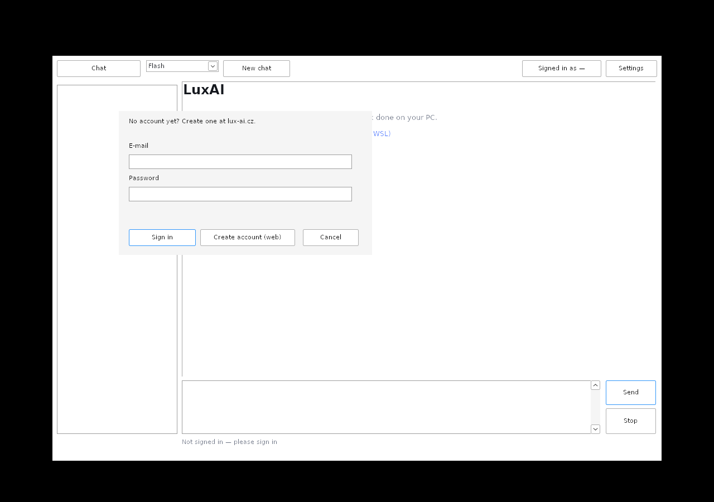
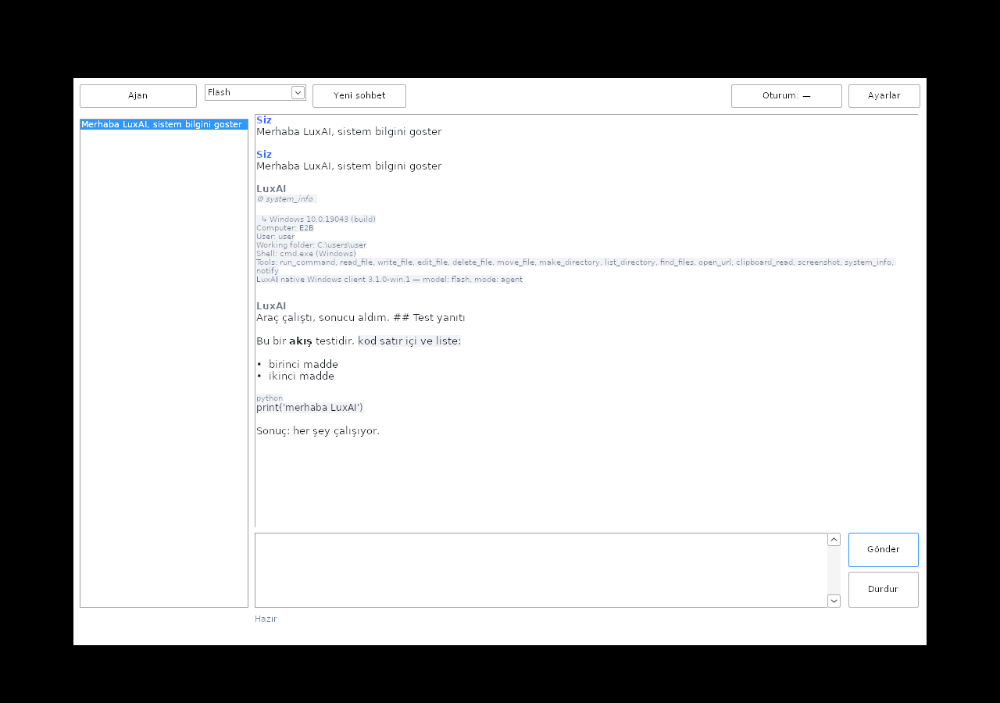
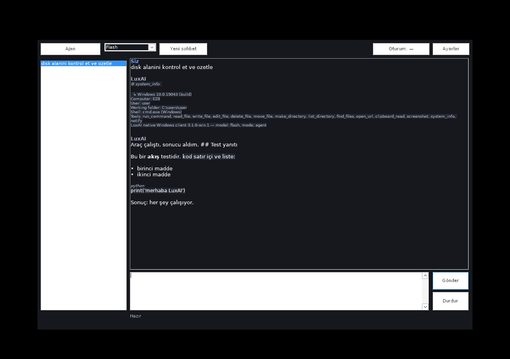
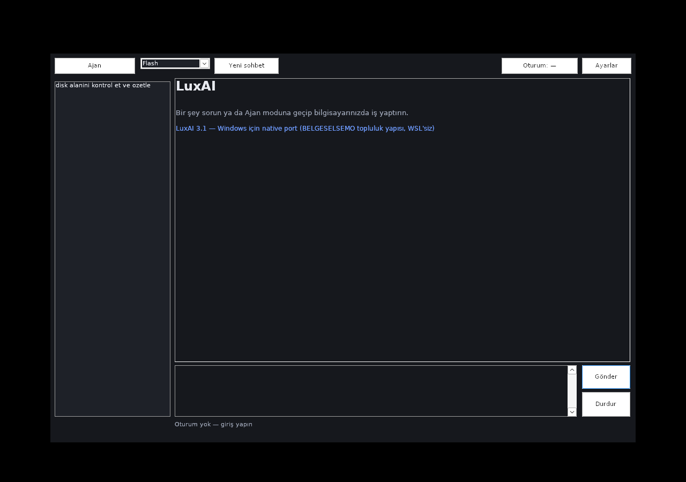

# LuxAI — Native Windows (WSL'siz) sürüm

**LuxAI 3.1.0-win.1** · Windows 7 SP1 / 8 / 8.1 / 10 / 11 · x64 · tek dosya · kurulum gerekmez

Bu, `LuxAI-the-AI-assistant-for-LuxOS` deposundaki **LuxAI protokolunu** (aynı hesap, aynı
`lux-ai.cz` uç noktası, aynı SSE akışı) uygulayan, **sıfırdan C ile yazılmış native Win32
istemcisidir**. GTK yok, WSL yok, .NET yok, harici DLL yok.

> ❗ Orijinal `LuxAI-3.1.0-Setup.exe` bir Windows programı değildi: WSL kurup içine `.deb`
> yükleyen bir araçtı (WSL'siz native şart). Bu port ise **doğrudan Windows uygulaması**dır.
> Neden orijinali kaynaktan derlemenin mümkün olmadığı: `../ANALIZ.md` (bölüm 11).

---

## Hızlı başlangıç

1. `LuxAI-Setup.exe` → kurar, Başlat menüsü + masaüstü kısayolu oluşturur, uygulamayı açar.
   (Alternatif: `LuxAI.exe` tek dosya olarak da çalışır.)
2. İlk açılışta **LuxAI hesabınla** giriş yap (e-posta + parola).
   Hesabın yoksa: <https://lux-ai.cz/register>
3. **Sohbet** modunda sor; **Ajan** moduna geçince bilgisayarında iş yapabilir (her yazan eylem
   için onay ister).

Kurulumsuz kaldırma: `%LOCALAPPDATA%\LuxAI` klasörünü ve iki kısayolu sil.
Kuruluysa: **Programlar ve Özellikler → LuxAI → Kaldır** (`uninstall.cmd`).

---

## Ekran görüntüleri (Wine + Xvfb üzerinde gerçek çalıştırma)

| | |
|---|---|
|  |  |
| Hesap girişi | Ajan modu: araç çağrısı + sonuç + Markdown |
|  |  |
| Koyu tema | Kurulumdan sonra ilk açılış |

---

## Özellikler

* **Sohbet:** akış halinde yanıt (SSE), Markdown (başlık, **kalın**, *italik*, `kod`, kod blokları,
  madde listeleri, tablolar), kopyalanabilir metin, sohbet geçmişi kenar çubuğunda.
* **Ajan (14 Windows aracı):** `run_command` (cmd.exe), `read_file`, `write_file`, `edit_file`,
  `delete_file`, `move_file`, `make_directory`, `list_directory`, `find_files`, `open_url`,
  `clipboard_read`, `screenshot` (BMP), `system_info`, `notify`.
* **Güvenlik:** yazan araçlar için onay penceresi, "ajan eylemlerini otomatik onayla" anahtarı,
  sert blok listesi (`format`, `diskpart`, `bcdedit`, `del /s /q C:\`, `vssadmin delete`,
  `reg delete HKLM`, `net user`, `powershell -enc`, …). Reddedilen eylemi model tekrar denerse
  araç "kullanıcı reddetti" sonucu döner.
* **Modeller:** `Flash` (görsel destekli, hızlı) ve `Lite`.
* **Arayüz dili:** Türkçe / English (sistem diline göre otomatik; Ayarlar'dan değiştirilir).
* **Tema:** Sistem / Açık / Koyu.
* **Alternatif arka uç:** Ayarlar → "OpenAI uyumlu uç nokta kullan" + Endpoint + API anahtarı
  (kendi sunucun, LM Studio, OpenRouter, OpenAI…). LuxAI hesabı olmadan da çalışır.
* **Tanılama:** son istek/yanıt `%APPDATA%\LuxAI\last_request.json` ve `last_response.txt`
  (parola/anahtar yazılmaz).

## Dosyalar

| Yol | İçerik |
|---|---|
| `%APPDATA%\LuxAI\settings.ini` | ayarlar |
| `%APPDATA%\LuxAI\account.json` | oturum tokenı + kullanıcı |
| `%APPDATA%\LuxAI\conversations\*.json` | sohbetler |
| `%APPDATA%\LuxAI\shots\*.bmp` | ajan ekran görüntüleri |
| `%LOCALAPPDATA%\LuxAI\LuxAI.exe` | kurulu uygulama |

## Kaynak yapısı

```
src/
├── luxai.h          ortak tanımlar (API sözleşmesi yorumlarda)
├── main.c           giriş noktası, tek örnek kilidi
├── util.c           UTF-8/UTF-16, dinamik tampon, dosya yolları
├── json.c           küçük JSON ayrıştırıcı (SSE/yanıtlar için)
├── http.c           WinHTTP istemcisi (TLS 1.2, akış sink'i)
├── config.c         ayarlar (ini) + hesap (json) + TR/EN metin tablosu
├── i18n_ids.h       çeviri anahtarları (TR/EN)
├── prompt.c         sistem istemleri (orijinalden Windows'a uyarlandı)
├── chat.c           istek kurma, SSE ayrıştırma, ajan araç döngüsü
├── tools.c          araç uygulamaları + güvenlik blokları
├── ui.c             Win32 arayüz, Markdown→RichEdit, giriş/ayarlar pencereleri
└── tools.json       araç şeması (modele gönderilen JSON)
installer/luxai_setup_win.c   native kurucu (exe'yi gömer, kısayol + kaldırma kaydı)
cmd/luxai-kur.bat             cmd ile tek satır kurulum (kısayol + kaldırma kaydı)
cmd/luxai-kaldir.bat          cmd ile kaldırma
res/                 ikon, manifest (Common Controls v6, DPI-aware, supportedOS Win7-11)
```

## Derleme

```bash
sudo apt install gcc-mingw-w64-x86-64 binutils-mingw-w64-x86-64 python3
bash build-win.sh          # → build/LuxAI.exe      (~257 KB)
bash build-installer.sh    # → build/LuxAI-Setup.exe (~653 KB, exe'yi gömer)
```

Windows üzerinde derlemek istersen: MSYS2 + `pacman -S mingw-w64-x86_64-gcc python`
ve aynı komutlar (betikler `mingw32-make` gerektirmez, saf gcc + windres).

## Windows 7 notu (önemli)

Uygulama PE alt sistem sürümü **6.1** olarak işaretli ve yalnız Win7'de bulunan API'lerle
(`WinHTTP`, `msftedit.dll`, Common Controls v6) çalışır. Ancak `lux-ai.cz` **TLS 1.2** istiyorsa
Windows 7'de şunlar gerekir:

1. **KB3140245** güncellemesi (WinHTTP için TLS 1.2 desteği),
2. Kayıt defteri: `HKLM\SOFTWARE\Microsoft\Windows\CurrentVersion\Internet Settings\WinHttp`
   → `DefaultSecureProtocols = 0xA00` (TLS 1.1+1.2) ve
   `HKLM\SYSTEM\CurrentControlSet\Control\SecurityProviders\SCHANNEL\Protocols\TLS 1.2\Client`
   → `Enabled=1`, `DisabledByDefault=0`,
3. Güncel kök sertifikalar (`rootsupd`).

Aksi halde uygulama açılır, giriş denemesinde "sunucuya ulaşılamadı" der.

## Test

`tests/mock_server.py` — LuxAI/OpenAI uyumlu sahte SSE sunucusu; akış, araç çağrısı döngüsü ve
Markdown biçimlendirmesini hesap olmadan denemek için:

```bash
python3 tests/mock_server.py 8777
# Ayarlar → OpenAI uyumlu uç nokta kullan ✓
# Endpoint: http://127.0.0.1:8777/v1/chat/completions
# API anahtarı: test   ·  Mod: Ajan
```

## Lisans / sorumluluk

Topluluk yapısı; LuxOS projesiyle bağlantılı değildir. Orijinal depo MIT lisanslıdır, LuxAI
uygulamasının kendisi LuxOS dağıtımından gelir. Bu istemci bağımsız bir yeniden uygulamadır;
`lux-ai.cz` hizmet şartlarına ve hesabının kullanım kurallarına uymak senin sorumluluğundadır.
